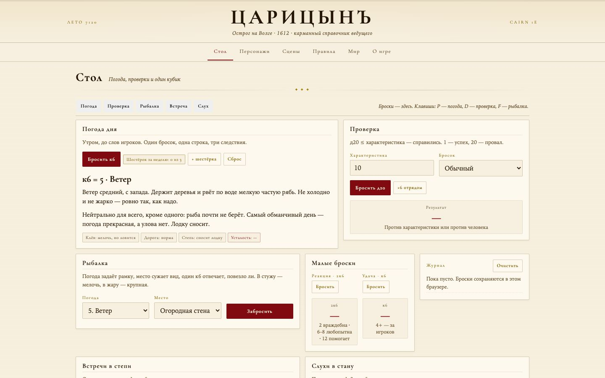

# Царицынъ, 1612 — карманный справочник ведущего

Одностраничное офлайн-приложение для игры на **Cairn 1e**: стол ведущего, генераторы, конспект правил и справка по Царицыну 1612 года. Один HTML-файл, без сервера и сборки; данные хранятся в localStorage браузера.

**Демо:** https://chipsfirst.github.io/Tsaritsyn/

## Возможности

### Стол
- **Погода дня** — бросок к6, следствия для степи, Волги и рыбалки.
- **Проверка** — д20 против характеристики или против человека, с броском за отряд.
- **Рыбалка** — погода задаёт рамку, место сужает выбор.
- **Встречи в степи** и **слухи в стане** — таблицы на день.
- **Малые броски** — реакции и удача.
- Журнал бросков и горячие клавиши: `P` — погода, `D` — проверка, `F` — рыбалка.

### Персонажи
- Генератор персонажа в один клик: имя на ходу, происхождение, чем живёт.
- Список своих персонажей и заметки к ним, хранение в браузере.
- Печать листа на A4.

### Сцены
- Генератор сцен и подсказка «Что сегодня» для подготовки игры.
- Таблицы «Кто сошёл с лодки», «Кто кому и что должен».

### Правила
- Шпаргалка ведущего, «Провал как развитие», «Первая ночь», «Как это считается» — конспект Cairn 1e для стола.

### Мир
- Схема города и окрестностей, «Где что», люди и фракции.
- Рынок: цены и торг, энциклопедия рыб, соль, поход в степь, быт, что можно построить.

## Данные и сохранение

Всё состояние хранится локально в `localStorage`. В интерфейсе есть **«Экспорт данных»** и **«Импорт»** — резервная копия переносится между браузерами вручную. Сервер и внешние запросы не используются.

## Запуск

- **Демо** — открыть ссылку выше.
- **Локально** — скачать репозиторий и открыть `index.html` в браузере.

## Стек

Ванильные HTML, CSS и JavaScript без зависимостей и сборки. Вся логика, таблицы и тексты — в одном файле `index.html`.

## Лицензия

Код — [MIT](LICENSE). Игровые тексты, названия и данные принадлежат их правообладателям и этой лицензией не покрываются.
